# **Penetration Testing Report**

| **Pentester Name** | Elijah Cauyan |
| --- | --- |
| **Batch** | B084-Networkwalks |
| **Date** | November 12, 2026 |
| **Modules Completed** | W2-PM1(Multiple Kali Tools) W2-PM5 (Zenmap Scanning) |
| **Client/Target** | Networkwalks (secured written permission already) My own LAN Network |
| **Permission secured from client?** | Yes |
| **Phases Covered** | Phase 1: Reconnaissance & Footprinting Phase 2: Scanning & Network Discovery Phase 3-5: In Progress |
 

**LIABILITY DISCLAIMER**

During this report, I have performed penetration testing activities on authorized systems & devices, and some being my own.  All the steps and procedures shown in the report are all purely for educational purposes and must not be used to harm others nor break the law. The instructors, authors, and Networkwalks are not responsible for what you do with this knowledge, and any action you take is your own responsibility; misuse of the knowledge can lead to criminal charges, penalties, and a permanent record.
 
 

  
**INTRODUCTION**

This report covers reconnaissance on the website “Networkwalks.com”, wherein multiple reconnaissance tools and Kali Linux tools are used to find valuable information about the target before continuing with the penetration testing. Furthermore, this report is a combination of W2-PM1 and W2-PM5 from my Week 2 Cybersecurity internship with Networkwalks. All the tools and commands that were used are shown later in the document. The results and findings will be compiled and discussed for a deeper understanding of the penetration testing process.
 
 

**TOOLS USED**

| **Tool** | **Purpose** |
| --- | --- |
| Kali Linux | Operating System used for reconnaissance tools and activities |
| Whois | Finds domain registration details |
| Whatweb | Identifies web technologies, frameworks, and server information |
| Nslookup | Retrieves DNS information and resolves domain names |
| Curl -l | Retrieves HTTP response headers |
| Wafw00f | Detects whether there is a Web Application Firewall that protects the website |
| Dnsrecon | Enumerates DNS records and related information |
| Zenmap (Nmap GUI) | Provides a graphical interface for Nmap network scanning |
| Linux Terminal | Provides Linux command-line functionality |
 

**ACTIVITIES PERFORMED**

**RECONNAISSANCE PROCESS**

In this section of the Penetration testing report, it will cover the reconnaissance/footprinting process in finding out bits of information about Networkwalks.com using various tools such as: whois, whatweb, nslookup, curl -I, wafw00f, and dnsrecon.
 
 

**Whois**

Figure 1: Whois results
 
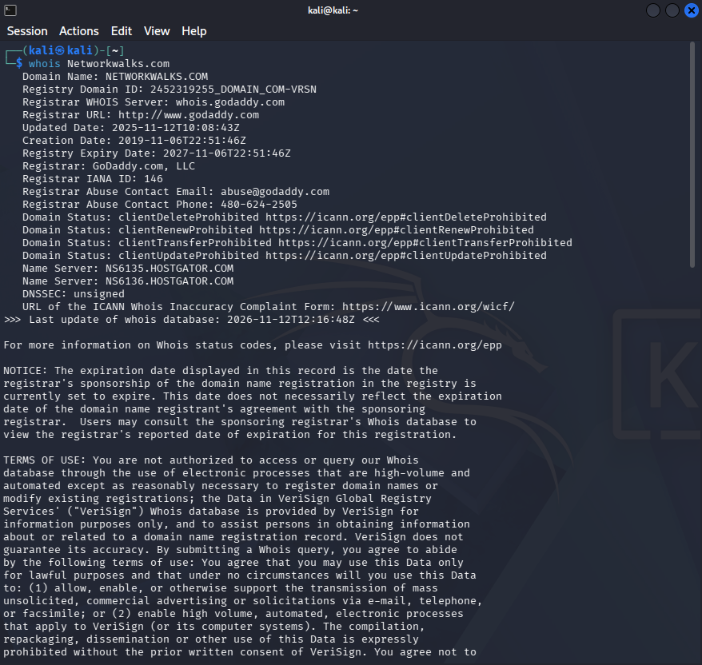
 
Figure 1.1:
 
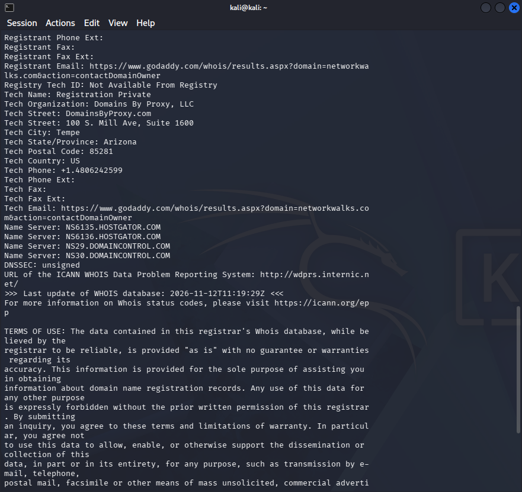
 
Figure 1.2:
 
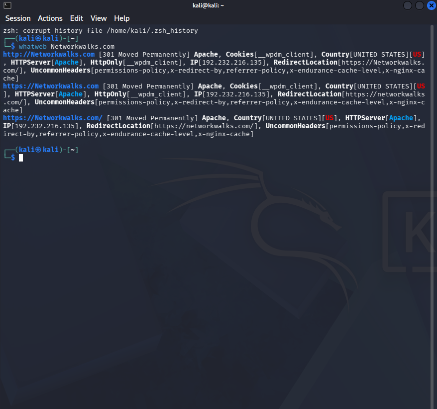
 
The first step in this reconnaissance process is to use Kali Linux’s “whois” tool, which gave me the registration details of Networkwalks.com. As shown in Figure 1, Figure 1.1, and Figure 1.2, we can see that after running the command “whois Networkwalks.com”, we see the Domain name, Registry WHOIS, Registrar URL, Updated Date, Creation Date, and many more public information about Networkwalks.com.
 
 

**Whatweb**

Figure 2: Whatweb results
 
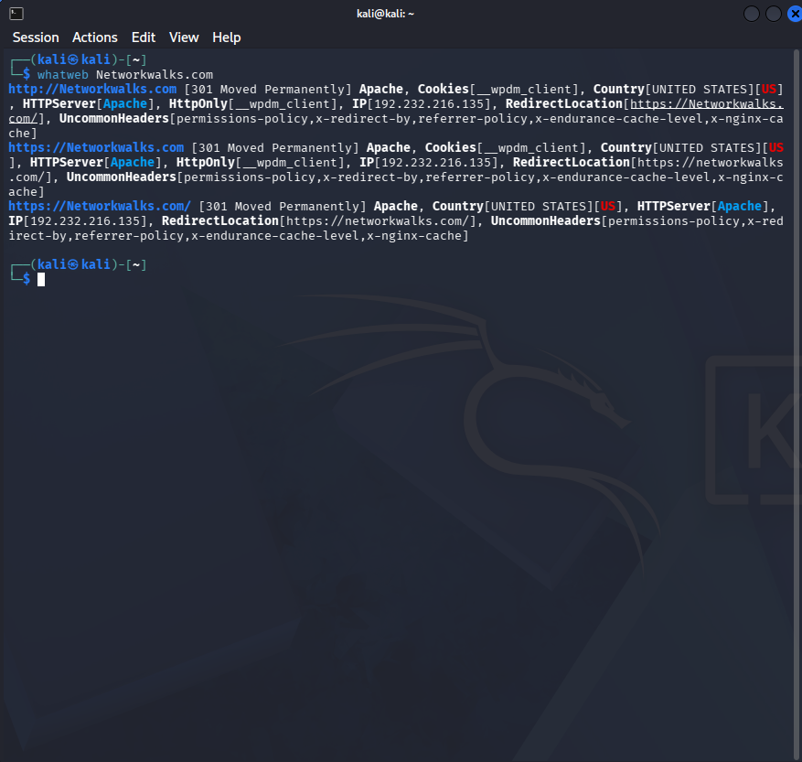
 
The second step in the reconnaissance process is to use “whatweb”. As shown in Figure 2, the command “whatweb Networkwalks.com” was executed, which shows that Apache is the web server of the target, on top of that, the IP address is “192.232.216.135”, as well as showing that the website redirect visitors to its HTTPS version and provided information regarding cookies associated with the website. This is extremely useful during reconnaissance because identifying the technologies being used by the website you’re targeting can help penetration testers like myself understand the environment before proceeding further in the testing.
 
 

**Nslookup**

Figure 3: Nslookup results
 
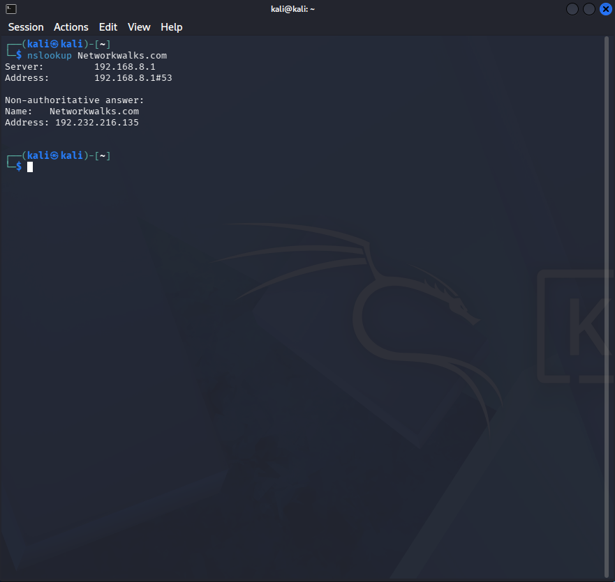
 
The third step in the reconnaissance process is to use “nslookup”. As shown in Figure 3, the command “nslookup Networkwalks.com” was executed, which allowed me to identify the domain name to its IP address, it being “192.232.216.135”.
 
 

**Curl**

Figure 4: Curl -I results
 
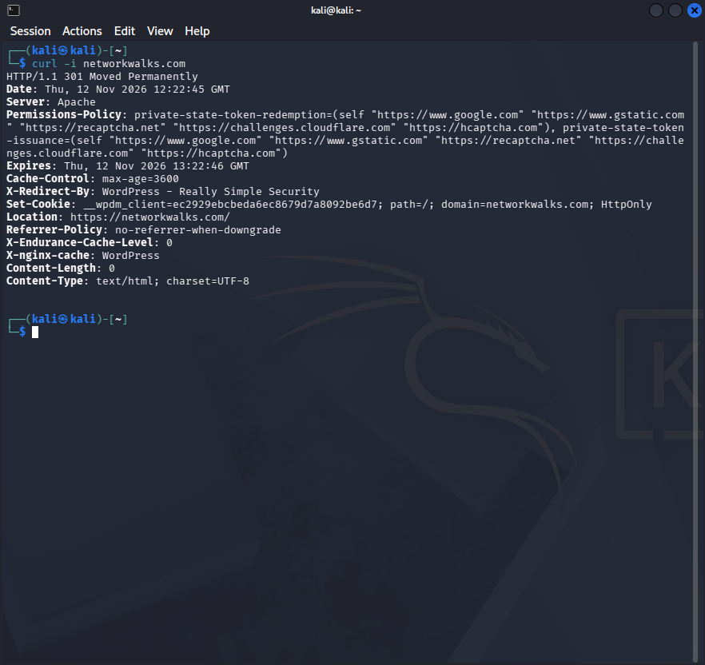
 
The fourth step in the reconnaissance process is to use “Curl -I”. As shown in Figure 4, the command “curl -I networkwalks.com” was executed, and I noticed that the website returned a “301 Moved Permanently” response, which indicates that visitors accessing the website are being redirected to its HTTPS version, similar to my findings in Figure 2, which provides encrypted communication between the website and its visitors.

Additionally, another interesting finding is the “X-Redirect-By” header, which identifies WordPress as the application that is responsible for handling the redirect. Along with this, the “Server” header also identifies Apache as the web server being used.

Furthermore, the results included a “Cache-Control” header with a max-age value of 3600 seconds, which means that certain responses can be cached for up to an hour.

Lastly, the “Set-Cookie” header also revealed a cookie containing the HttpOnly attribute, which helps prevent client-side scripts, like JavaScript, from directly accessing that specific cookie.
 
 

**Wafw00f**

Figure 5: Wafw00f results
 
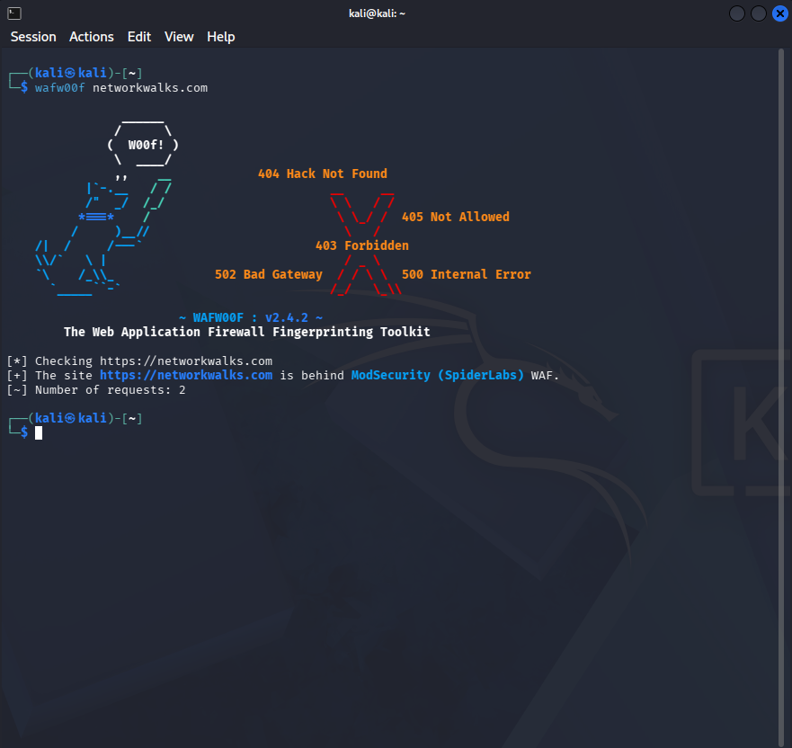
 
As shown in Figure 5, after running the command “wafw00f networkwalks.com” I was able to identify that Networkwalks.com uses ModSecurity (SpiderLabs) as its Web Application Firewall. This is valuable information because a WAF helps protect web applications by monitoring and filtering incoming HTTP requests that may contain potential malicious activities such as SQL injections and cross-site scripting. Based on this, it gives me an understanding of the security measures that are already in place to protect the website. However, a WAF alone does not guarantee that the website is fully secured, because vulnerabilities still may exist in the website.
 
 

**Dnsrecon**

Figure 6: Dnsrecon -d
 
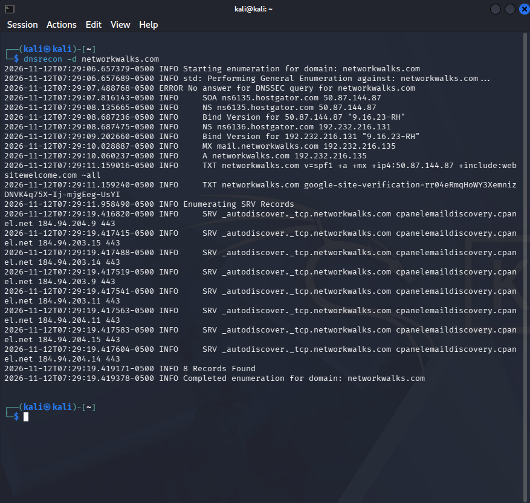
 
Finally, in the last step of the reconnaissance process, I used the tool “dnsrecon”. As shown in Figure 6, the command “dnsrecon -d networkwalks.com” was executed, which showed a handful of information such as the name servers, mail servers, DNS software information, and more.

Additionally, after reviewing the results further, I discovered the domain’s MX record, which points to “mail.networkwalks.com”. These records identify the mail servers responsible for receiving emails on behalf of a domain, which provides additional insights into the organization’s infrastructure.

 
  
**NETWORK SCANNING WITH ZENMAP**

Figure 7: Ifconfig
 
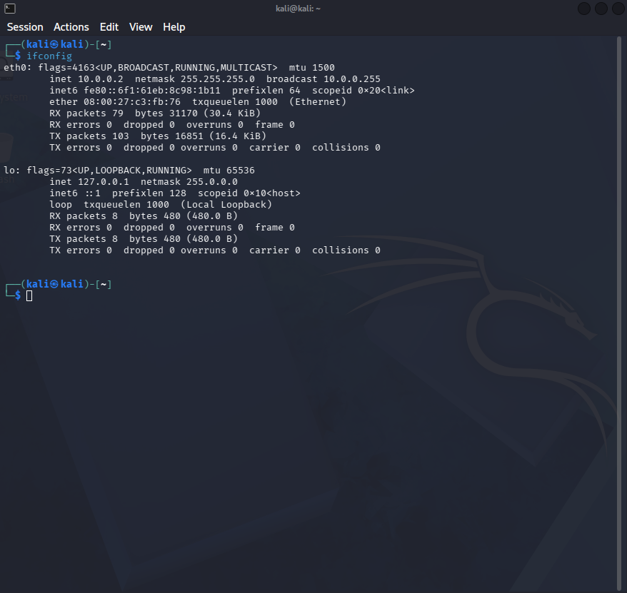
 
Figure 7.1: Zenmap quick scan
 
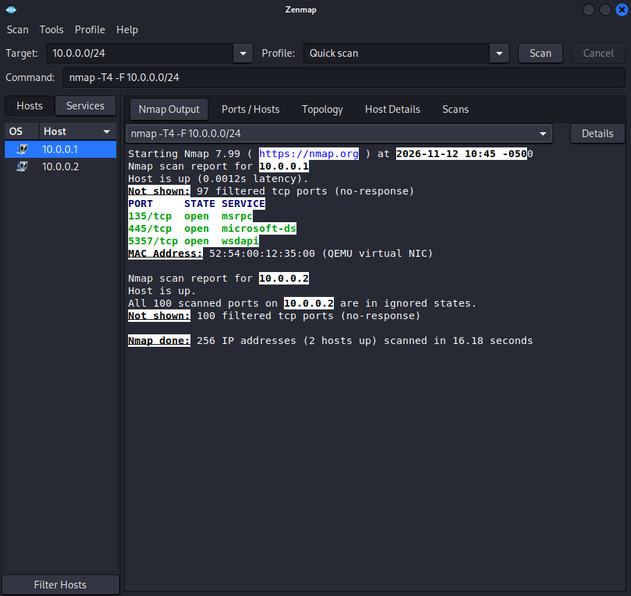
 
Figure 7.2: Zenmap Topology
 
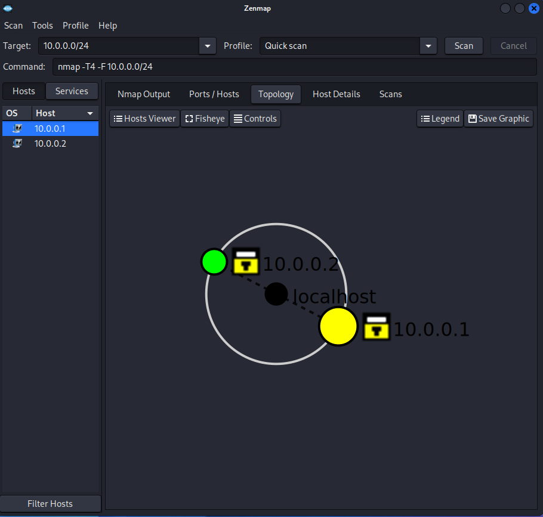
 
Figure 7.3: Topology PNG Download
 
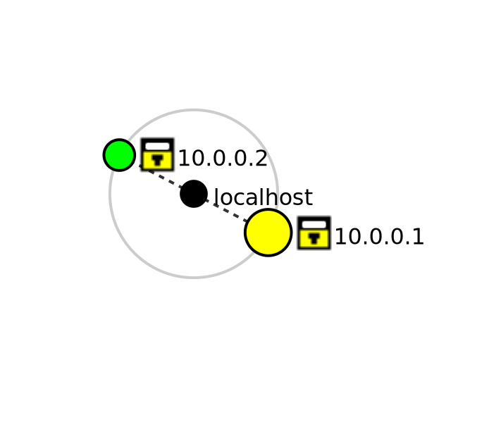
 
Figure 7.4: 10.0.0.1 Host Details
 
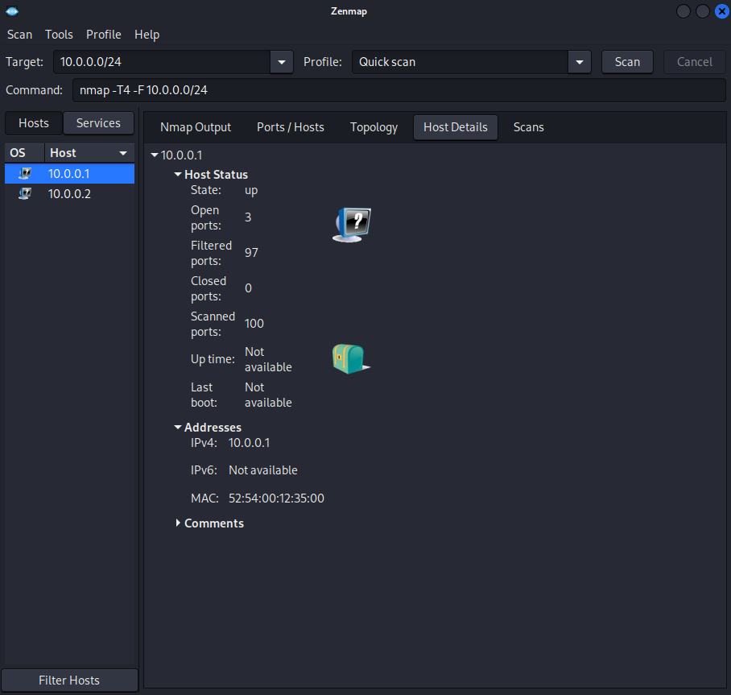
 
Figure 7.5: 10.0.0.2 Host Details
 
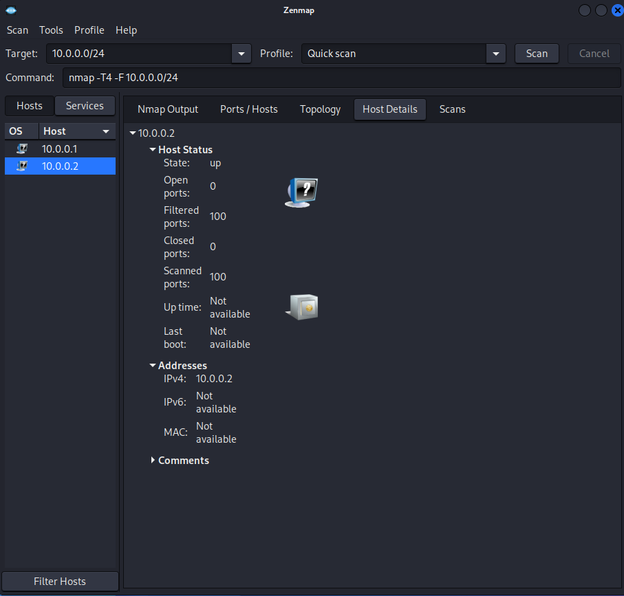
 
 

**Task 1: Download and install Zenmap**

I have already downloaded it on my Windows PC and have tested it; however, in this report, I will be showing the process of how I answered WK2-PM5 in Kali Linux for privacy reasons and anonymity. However, I will still be answering based on the results from my Kali Linux Zenmap.
 

**Task 2: Find IP Address & LAN Subnet**

As shown in Figure 7, the command “ifconfig” was executed in the terminal, which allowed me to see my IP address and my subnet.
 

**Task 3: Find the list of Live hosts in the IP subnet**

As shown in Figure 7.1, it shows the list of live hosts in my IP subnet after doing a quick scan for “10.0.0.0/24”
 

**Task 4**: **How many hosts are live in the subnet**

As shown in Figure 7.1, there are 2 live hosts in the subnet from the scan.
 

**Task 5: What are the IP Addresses of the live hosts?**

10.0.0.1

10.0.0.2
 

**Task 6: What are the MAC Addresses of the live hosts?**

As shown in Figure 7.4, for the host 10.0.0.1, the MAC address is “52:54:00:12:35:00”, and for Figure 7.5, for the host 10.0.0.2, the MAC address is not shown, therefore unknown as of now.
 

**Task 7: Display and save the output topology in PDF format on your desktop**
As shown in Figure 7.2 and Figure 7.3, it displays the topology of the scanned hosts.
 
 

**RISK ANALYSIS**

| **Risk** | **Evidence** | **Potential Impact** | **Risk Level** |
| --- | --- | --- | --- |
| Exposure of Web technology | Whatweb identified that the target uses Apache, WordPress, other website technology information. | Could help attackers understand which technologies are being used and be able to identify possible areas for further investigation. | Medium |
| Server IP address can be identified | Nslookup resolved Networkwalks.com to 192.232.216.135. | Exposed technology information may potentially help attackers to find software that. needs more security review. | Low |
| HTTP technical information exposed | Curl returned HTTP response headers, such as WordPress-related information, redirect details, and cookie attributes. | Provides additional details about the website’s configuration that could be used further during an attacker’s reconnaissance. | Low |
| WAF technology identifiable | Wafw00f identified the target’s being protected by ModSecurity (SpiderLabs) WAF. | Allows attackers to identify the WAF technology being used and learn more about the website’s security setup. | Low |
| DNS infrastructure information exposed | DNSRecon identified DNS records, such as mail server, and DNS software version details. | Could potentially help attackers understand the domain’s infrastructure as well as identify other services that may be looked into further during reconnaissance. | Medium |
 

**RECOMMENDATIONS**

- **Review publicly exposed information** - Review publicly available domain registration information and also consider using domain privacy protection to limit the exposure of any unnecessary registration details. This is not limited to what was shown by the tool “whois” but also all the other tools and more that were used for the reconnaissance process on the target.

- **Stay up-to-date** - Keep identifiable web technologies, such as Apache and WordPress updated to their latest supported versions and also review them for any known security vulnerabilities.

- **Review response headers** – Ensure you review response headers to minimize any unnecessary disclosure, and make sure that the website uses HTTPS and that cookies have appropriate security attributes, such as HttpOnly, Secure, etc.

- **Review DNS Configuration** – Review the DNS configurations and limit unnecessary information disclosure, particularly DNS software version details. Make sure that the DNS software is updated and that DNS records are properly configured.
 

**CONCLUSION**

In conclusion, the tasks WK2-PM1 and WK2-PM5, which were given by Networkwalks for my week 2 internship, were successfully completed. Throughout the penetration testing report, I was able to learn various penetration testing tools and techniques that are used by ethical hackers.

The key findings that I personally would like to highlight are how much publicly exposed information there truly is when there is a lack of review and security for websites, and this does not only apply to websites, but also to vulnerable systems that can be exploited.

Based on the tools that I was able to use in Kali Linux towards the target Networkwalks.com. I was able to find valuable information about them during the reconnaissance phase of the penetration testing. I identified the registration details, web technologies, server IP address, HTTP response information, WAF technology, and DNS records.

Apart from footprinting Networkwalks.com, I was also able to do hands-on work with Zenmap (Nmap GUI), which showed me and gave me the idea of how attackers gain more information about their targets, and most notably, what ports might be open that they can exploit, as those are vulnerabilities of systems.

Overall, I found the process exciting and knowledgeable, and look forward to working on week 3 of my internship with Networkwalks. Again, a huge thanks to Networkwalks for allowing me to be an intern at their organization, and Sir Waqas Karim for the guidance throughout the internship.
